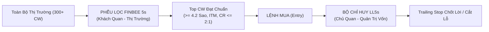

# QUY CHUẨN MÔ HÌNH ĐỊNH LƯỢNG & TỐI ƯU DANH MỤC CHỨNG QUYỀN (CW)
## HỆ THỐNG PHỐI HỢP: MÔ HÌNH FINBEE 5s & MÔ HÌNH LL5s

---

## 🎯 1. TỔNG QUAN & TRIẾT LÝ PHỐI HỢP CHIẾN LƯỢC

Trong đầu tư Chứng Quyền Có Bảo Đảm (Covered Warrants - CW), sai lầm phổ biến nhất của nhà đầu tư là dùng chung một thước đo cho cả việc **tìm mã để mua** và **quản lý mã đang giữ**. Hệ thống chuẩn hóa hai mô hình độc lập nhưng bổ trợ mật thiết:

1. **Mô hình Finbee 5s (Chiếc Phễu Lọc Vào):** 
   - **Định vị:** Khách quan - Toàn cảnh thị trường.
   - **Nhiệm vụ:** Chấm điểm độc lập từng mã CW tại thời điểm hiện tại để trả lời câu hỏi: *"Mã này có đủ an toàn, đủ đòn bẩy và đủ thanh khoản để giải ngân hay không?"*
2. **Mô hình LL5s (Bộ Chỉ Huy Tác Chiến):**
   - **Định vị:** Chủ quan - Gắn liền tài khoản thực tế.
   - **Nhiệm vụ:** Lấy giá vốn ban đầu ($C_{\text{entry}}$), khối lượng nắm giữ và tỷ trọng làm trọng tâm để trả lời: *"Cổ phiếu mẹ cần tăng bao nhiêu để tài khoản về bờ hoặc đạt mục tiêu chốt lời? Mỗi ngày danh mục bốc hơi bao nhiêu tiền mặt?"*

---

## ⚖️ 2. BẢNG ĐỐI CHIẾU TIÊU CHUẨN CHI TIẾT (5 TRỤC THÀNH PHẦN)

| Trục tiêu chuẩn | Mô hình Finbee 5s *(Bộ lọc sàng lọc thị trường)* | Mô hình LL5s *(Quản trị vị thế & Tối ưu danh mục thực chiến)* |
| :--- | :--- | :--- |
| **1. Bản chất & Định vị** | **Khách quan - Toàn cảnh thị trường:** Chấm điểm độc lập từng mã chứng quyền tại thời điểm hiện tại để trả lời câu hỏi: *"Mã này có đủ an toàn để giải ngân hay không?"* | **Chủ quan - Gắn liền tài khoản thực tế:** Lấy giá vốn ban đầu ($C_{\text{entry}}$) và tỷ trọng làm trọng tâm để trả lời: *"Cổ phiếu mẹ cần tăng bao nhiêu để tài khoản về bờ/chốt lời?"* |
| **2. Tiêu chí 1: Trạng thái Moneyness** | **Độ lệch thị trường so với Strike ($K$):**  $$\% \text{Moneyness} = \frac{S - K}{S} \times 100\%$$ Ưu tiên mã đã vào ITM ($> +5\%$) có sẵn lãi nội tại tiền tươi. | **Độ lệch giá vốn so với hòa vốn thực tế ($S_{\text{be}}$):**  Đo khoảng cách từ thị giá cổ phiếu mẹ $S$ tới ngưỡng hòa vốn của bạn: $$S_{\text{be}} = K + (C_{\text{entry}} \times \text{CR})$$ |
| **3. Tiêu chí 2: Yếu tố thời gian (Span/Time)** | **Cửa sổ an toàn 120 ngày:**  Lọc mã có thời hạn $> 120$ ngày để triệt tiêu hao mòn thời gian ($\text{Theta Decay}$), loại thẳng tay mã $< 90$ ngày OTM. | **Độ nhạy bào mòn trên tổng vốn nắm giữ:**  Tính toán mức hao mòn tiền mặt thực tế mỗi ngày: $$\text{Thâm hụt/ngày} = \text{Theta} \times \text{Khối lượng CW}$$ để quyết định thời điểm dừng gồng lỗ. |
| **4. Tiêu chí 3: Điểm hòa vốn (Strike / Breakeven)** | **Hòa vốn theo thị giá khớp lệnh hiện tại ($CW_{\text{market}}$):**  $$\text{Hòa vốn TT} = K + (CW_{\text{market}} \times \text{CR})$$ Cần cổ phiếu mẹ tăng $< +7\%$ (trong biên độ 1 cây trần sàn HOSE). | **Biên độ giá mẹ cần tăng để về bờ gốc:**  $$\% \text{Tăng cần có} = \frac{S_{\text{be}} - S}{S} \times 100\%$$ Đánh giá tính khả thi theo kháng cự kỹ thuật của cổ phiếu mẹ. |
| **5. Tiêu chí 4: Tỉ lệ chuyển đổi (Split / Ratio)** | **Độ cô đặc danh nghĩa ($\text{CR}$):**  Ưu tiên $\text{CR} \le 2:1$ (siêu cô đặc), loại trừ mã pha loãng $\text{CR} > 5:1$ do bước giá nhảy chậm và dễ kẹt lệnh. | **Tác động bước giá quy đổi tiền mặt:**  Tính số tiền CW nhận thêm trên mỗi $1,000$đ cổ phiếu mẹ tăng: $$\Delta CW = \frac{1,000\text{đ}}{\text{CR}} \times \text{Delta}$$ |
| **6. Tiêu chí 5: Đòn bẩy & Quy mô (Size / Liquidity)** | **Thanh khoản & Năng lực tạo lập:**  Dựa vào khối lượng giao dịch phiên ($> 700\text{k} - 1.5\text{M}$ CW) và bước giá Bid/Ask của CTCK phát hành. | **Đòn bẩy hiệu dụng thực tế ($\Omega$):**  $$\Omega = \text{Delta} \times \text{Gearing}$$ Đo lường biên độ nảy của danh mục khi cổ phiếu mẹ biến động $+3\%, +5\%, +7\%$. |
| **7. Ngưỡng hành động chuẩn hóa** | **Chấm điểm theo thang ⭐ (1.0 - 5.0):**  • $\ge 4.2$ ⭐: Top Tier / Giải ngân chủ lực • $3.5 - 4.1$ ⭐: Khá / Mua thăm dò • $3.0 - 3.4$ ⭐: Trung bình / Theo dõi • $< 3.0$ ⭐: Rủi ro cao / Bán thoát hàng | **Kỷ luật giao dịch tài khoản cá nhân:**  • **Quy tắc Trailing Stop:** Khóa lãi khi CW lãi $\ge +20\%$. • **Quy tắc Thoát hàng hòa vốn:** Thoát dứt điểm khi CW chạm mốc vốn gốc $C_{\text{entry}}$. • **Quy tắc Cấm DCA âm:** Tuyệt đối không bình quân giá xuống mã OTM cận hạn. |

---

## 🧮 3. CÔNG THỨC TOÁN HỌC & ĐỊNH LƯỢNG CHI TIẾT

### 3.1. Các Biến Số Cơ Bản
- $S$: Thị giá hiện tại của Cổ phiếu cơ sở (Underlying Price).
- $K$: Giá thực hiện của Chứng quyền (Exercise / Strike Price).
- $CW_{\text{market}}$: Thị giá hiện tại của Chứng quyền trên sàn.
- $C_{\text{entry}}$: Giá vốn mua thực tế của nhà đầu tư.
- $\text{CR}$: Tỉ lệ chuyển đổi (Conversion Ratio - ví dụ $2:1 \implies \text{CR} = 2$).
- $T$: Số ngày còn lại đến khi đáo hạn (Days to Maturity).
- $Q$: Khối lượng chứng quyền nắm giữ.

---

### 3.2. Công Thức Mô Hình Finbee 5s (Market Screening)

1. **Điểm Moneyness ($S_1$):**
   $$\% \text{Moneyness} = \frac{S - K}{S} \times 100\%$$
   - $> +5\% \implies 5$ ⭐ (`ITM sâu`)
   - $0\% \to +5\% \implies 4$ ⭐ (`ITM nhẹ`)
   - $-5\% \to 0\% \implies 3$ ⭐ (`OTM nhẹ`)
   - $< -5\% \implies 1 - 2$ ⭐ (`OTM sâu`)

2. **Điểm Thời Hạn ($S_2$):**
   - $T \ge 180$ ngày $\implies 5$ ⭐
   - $120 \le T < 180$ ngày $\implies 4$ ⭐
   - $90 \le T < 120$ ngày $\implies 3$ ⭐
   - $45 \le T < 90$ ngày $\implies 2$ ⭐
   - $T < 45$ ngày $\implies 1$ ⭐

3. **Điểm Hòa Vốn Thị Trường ($S_3$):**
   $$S_{\text{be\_market}} = K + (CW_{\text{market}} \times \text{CR})$$
   $$\% \text{Breakeven} = \frac{S_{\text{be\_market}} - S}{S} \times 100\%$$
   - $\le 5\% \implies 5$ ⭐
   - $5\% \to 10\% \implies 4$ ⭐
   - $10\% \to 15\% \implies 3$ ⭐
   - $> 20\% \implies 1$ ⭐

4. **Điểm Tỉ Lệ Chuyển Đổi ($S_4$):**
   - $\text{CR} \le 2.05 \implies 5$ ⭐ (Rất cô đặc)
   - $2.05 < \text{CR} \le 3.05 \implies 4$ ⭐
   - $3.05 < \text{CR} \le 4.05 \implies 3$ ⭐
   - $\text{CR} > 6.05 \implies 1$ ⭐ (Pha loãng cao)

5. **Điểm Thanh Khoản ($S_5$):**
   - Khối lượng phiên $\ge 1,000,000$ CW $\implies 5$ ⭐
   - $500,000 \le \text{KL} < 1,000,000 \implies 4$ ⭐
   - $200,000 \le \text{KL} < 500,000 \implies 3$ ⭐
   - $\text{KL} < 50,000 \implies 1$ ⭐

$$\text{Điểm Tổng Hợp Finbee 5s} = \frac{S_1 + S_2 + S_3 + S_4 + S_5}{5}$$

---

### 3.3. Công Thức Mô Hình LL5s (Portfolio Position Risk)

1. **Ngưỡng Hòa Vốn Thực Tế Theo Vốn Gốc ($S_{\text{be\_entry}}$):**
   $$S_{\text{be\_entry}} = K + (C_{\text{entry}} \times \text{CR})$$

2. **Biên Độ Cổ Phiếu Mẹ Cần Tăng Để Về Bờ:**
   $$\% \text{Recovery Gap} = \frac{S_{\text{be\_entry}} - S}{S} \times 100\%$$
   - Nếu $\% \text{Recovery Gap} \le 0\%$: Vị thế đang có lãi tự nhiên.
   - Nếu $0\% < \% \text{Recovery Gap} \le 5\%$: Về bờ khả thi trong 1 nhịp hồi kỹ thuật.
   - Nếu $\% \text{Recovery Gap} > 15\%$: Khả năng về bờ cực thấp, kích hoạt điều kiện bán cắt lỗ.

3. **Mức Độ Hao Mòn Tiền Mặt Theo Ngày (Daily Cash Burn):**
   $$\text{Thâm Hụt Tiền Mặt/Ngày} = \text{Theta} \times Q$$
   *(Cho biết mỗi ngày mở mắt ra bạn mất bao nhiêu triệu đồng tiền phí thời gian nếu cổ phiếu mẹ đứng yên).*

4. **Đòn Bẩy Hiệu Dụng Thực Tế (Effective Gearing - $\Omega$):**
   $$\text{Gearing} = \frac{S}{CW_{\text{market}} \times \text{CR}}$$
   $$\Omega = \text{Delta} \times \text{Gearing}$$
   - Cho biết: Nếu cổ phiếu mẹ tăng $+1\%$, thị giá CW sẽ tăng xấp xỉ $+\Omega\%$.

---

## 🛡️ 4. BỘ QUY TẮC KỶ LUẬT THỰC CHIẾN (LL5s TRADING RULES)

> [!IMPORTANT]
> Đây là 3 nguyên tắc sống còn bảo vệ vốn tuyệt đối cho nhà đầu tư khi giao dịch chứng quyền:

### 1. Quy tắc Khóa Lãi (Trailing Stop)
- Khi vị thế CW đạt mức lãi $\ge +20\%$, dời ngưỡng dừng lỗ lên mức **hòa vốn ($C_{\text{entry}}$)**.
- Khi CW lãi $\ge +40\%$, nâng mức bảo vệ lên **$+20\%$ lợi nhuận**, không để một lệnh thắng lớn biến thành lệnh thua.

### 2. Quy tắc Thoát Hàng Hòa Vốn (Breakeven Exit)
- Khi giá CW quay đầu giảm về chạm đúng giá vốn $C_{\text{entry}}$, **bán dứt điểm 100% vị thế**, chấp nhận hòa phí để tái lập sức mua.

### 3. Quy tắc Cấm Bình Quân Giá Xuống (Strict No-DCA Down)
- **TUYỆT ĐỐI KHÔNG mua trung bình giá giảm** đối với chứng quyền đang lỗ, đặc biệt khi thời gian $T < 60$ ngày và đang ở trạng thái OTM.
- Chứng quyền có đặc tính bốc hơi theo thời gian. Mua DCA chứng quyền lỗ tương đương với việc tăng tốc độ tự hủy tài khoản.

### 4. Quy tắc Khóa Điểm Bảo Vệ Khi Cận Hạn
- Nếu $T < 30$ ngày và $\% \text{Moneyness} < -10\%$: Hệ thống tự động khóa điểm đánh giá về mức sàn **$1.5$ ⭐** và phát tín hiệu: **`🚨 RỦI RO MẤT TRẮNG`**.

---

## 📌 5. QUY TRÌNH 4 BƯỚC VẬN HÀNH DANH MỤC TRÊN HỆ THỐNG

1. **Bước 1 (Quét thị trường):** Truy cập Tab **`⚡ 3. TOP 30 TIỀM NĂNG`** để lấy danh sách các mã thỏa mãn Finbee 5s ($\ge 3.4$ ⭐, đòn bẩy $\Omega$ cao nhất, thời gian $> 50$ ngày).
2. **Bước 2 (Giải ngân & Khởi tạo):** Sau khi mua, thêm mã vào **`📌 1. DANH MỤC NẮM GIỮ`**, nhập chính xác **Khối lượng** và **Giá vốn gốc ($C_{\text{entry}}$)**.
3. **Bước 3 (Giám sát tự động LL5s):** Hệ thống sẽ tự động cập nhật:
   - Tổng vốn đầu tư & Tổng giá trị hiện tại theo sàn SSI.
   - % Lãi/lỗ thực tế và số tiền lãi/lỗ theo thời gian thực.
   - Cảnh báo trạng thái chốt lời hoặc báo động rủi ro.
4. **Bước 4 (Kích hoạt lệnh đóng vị thế):** Bán khi chạm ngưỡng Trailing Stop chốt lời hoặc khi cổ phiếu cơ sở gãy hỗ trợ quan trọng.
